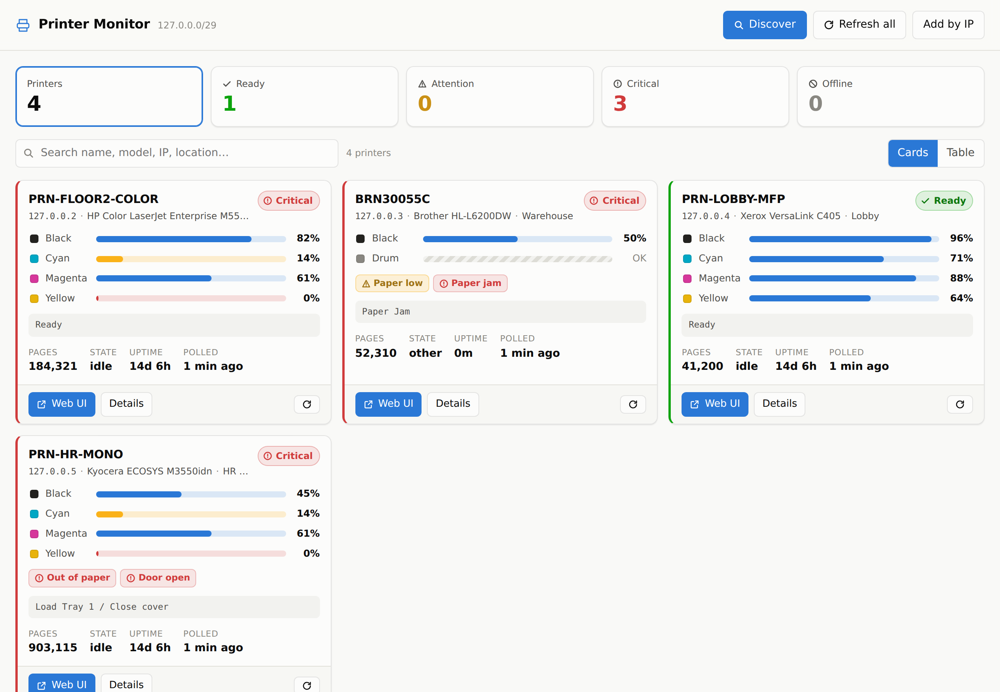
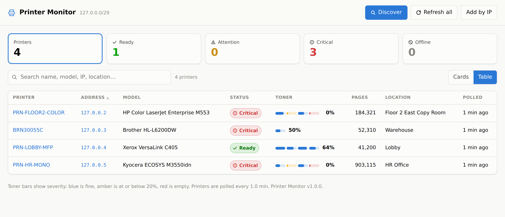
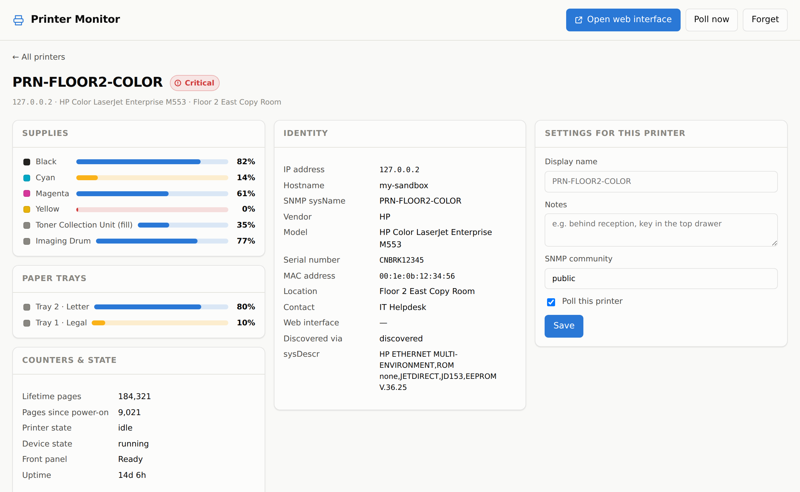

# Printer Monitor

A self-hosted web dashboard that finds the printers on your network by itself,
links straight through to each one's own web interface, and shows toner levels,
paper trays, page counts and error states for all of them on one page.

Built to run on IIS on Windows Server. Python + FastAPI, and only three
dependencies.



<sub>Screenshots taken against a simulated fleet, so the addresses are loopback ones.</sub>

<details>
<summary>Table view and per-printer detail</summary>





</details>

## What it does

- **Finds printers automatically.** Sweeps the subnets you configure over SNMP
  and keeps anything that exposes the standard Printer MIB. Switches, servers
  and UPSs that also answer SNMP are ignored.
- **One click to each printer's web interface.** Discovery probes for the
  embedded web server (443/80/8443/8080) and records the right URL, so the
  dashboard's "Web UI" button opens the real thing.
- **Toner and supply levels** for every cartridge, plus drums, fusers, waste
  toner bottles and staples — whatever the device reports. Bars are colour-coded
  by severity, not by cartridge, so a low one stands out at a glance.
- **General stats:** lifetime page count, pages since power-on, printer and
  device state, front-panel message, uptime, serial number, MAC, location.
- **Error states** decoded from the printer's own alert bits: paper jams, doors
  open, empty trays, service required, and the rest.
- Cards view, sortable table view, search, health filters, per-printer detail
  pages, and a JSON API for anything else you want to build.

## Requirements

- **Windows Server with IIS** (this runs equally well on Windows 10/11 with IIS).
- **Python 3.11 or newer**, installed for all users.
- **[HttpPlatformHandler 1.2](https://www.iis.net/downloads/microsoft/httpplatformhandler)** —
  the IIS module that lets IIS host a Python process.
- **SNMP v1/v2c enabled on your printers** with a read community string. This is
  on by default with the community `public` on most HP, Canon, Brother, Xerox,
  Lexmark, Kyocera and Ricoh network printers. It is how toner levels are read;
  there is no other vendor-neutral way to get them.
- UDP/161 open from the web server to the printer VLANs.

## Install on IIS

1. **Copy the app** to the server, e.g. `C:\inetpub\printer-monitor`.

2. **Create the virtual environment and install the dependencies:**

   ```bat
   cd C:\inetpub\printer-monitor
   C:\Python312\python.exe -m venv .venv
   .venv\Scripts\python.exe -m pip install -r requirements.txt
   ```

3. **Create your config:**

   ```bat
   copy config.example.json config.json
   notepad config.json
   ```

   At minimum set `subnets` to the ranges your printers live on, and
   `data_dir` to a writable folder. If you leave `subnets` out, the app guesses
   the server's own /24 and tells you so on the dashboard.

4. **Check it works before involving IIS:**

   ```bat
   .venv\Scripts\python.exe manage.py config
   .venv\Scripts\python.exe manage.py scan
   ```

   `scan` should list your printers. If it does not, see
   [Troubleshooting](#troubleshooting) — it is almost always SNMP, and it is
   much easier to fix here than through IIS.

5. **Add the IIS site.** In IIS Manager, add a website (or an application under
   an existing site) pointing at `C:\inetpub\printer-monitor`. The supplied
   `web.config` wires up HttpPlatformHandler; edit the two paths in it if you
   installed somewhere other than `C:\inetpub\printer-monitor`.

6. **Grant write access.** The app pool identity (by default
   `IIS AppPool\<your app pool name>`) needs Modify on the `data` and `logs`
   folders — that is where the printer inventory and the startup log are written.

7. **Keep the app pool alive.** This matters: the background poller lives inside
   the app process, so if IIS shuts the process down for being idle, polling
   stops until somebody loads the page again. On the app pool's Advanced
   Settings:

   - **Idle Time-out (minutes)** → `0`
   - **Regular Time Interval (minutes)** (under Recycling) → `0`
   - **Start Mode** → `AlwaysRunning`

   And on the site, enable **Preload Enabled** (requires the *Application
   Initialization* IIS feature). Without this the dashboard still works, but the
   figures will only be as fresh as the last time someone visited.

8. Browse to the site. The first sweep starts on its own; discovery progress
   shows at the top of the page.

### Hosting as a virtual application

If you add this as an application under an existing site (e.g.
`https://intranet/printers`), append the prefix to the uvicorn arguments in
`web.config` so links and API calls are built on it:

```
arguments="-m uvicorn app.main:app --host 127.0.0.1 --port %HTTP_PLATFORM_PORT% --no-access-log --root-path /printers"
```

## Configuration

Settings are read from `config.json` (path overridable with the
`PRINTER_MONITOR_CONFIG` environment variable), and any of them can be
overridden by an environment variable named `PRINTER_MONITOR_<KEY>`. See
`config.example.json` for every key with notes. The ones that matter most:

| Key | Default | Notes |
|---|---|---|
| `subnets` | autodetected /24 | CIDR ranges to sweep. Add one per printer VLAN. |
| `community` | `public` | SNMP v2c read community. |
| `communities` | `[]` | Extra communities to try, for a mixed fleet. |
| `exclude_ips` | `[]` | Addresses or ranges never to probe. |
| `manual_printers` | `[]` | Printers outside the swept ranges. |
| `poll_interval_seconds` | `300` | How often toner and status are re-read. |
| `discovery_interval_seconds` | `3600` | Re-sweep interval; `0` disables it. |
| `low_toner_threshold` | `20` | Percent at or below which a supply is amber. |
| `data_dir` | `./data` | Where `printers.json` is written. |
| `poller_enabled` | `true` | `false` serves the dashboard with no SNMP traffic. |

A sweep is capped at 8192 addresses per range, so a mistyped mask cannot turn
into an hours-long scan. Use several narrow ranges rather than one wide one.

## Troubleshooting

Everything below is quicker from the console than through the browser.

**A printer does not appear.** Probe it directly:

```bat
.venv\Scripts\python.exe manage.py probe 10.10.20.41
```

That prints exactly what the device answered, or tells you which of the three
usual causes applies:

- *No response* — SNMP is disabled on the printer, the community string is
  wrong, or UDP/161 is blocked. Check the printer's own web interface under
  Network → SNMP, and make sure **SNMPv1/v2c read** is enabled.
- *Answers SNMP but exposes no Printer MIB* — either it genuinely is not a
  printer, or the device has SNMP enabled only for management and not for
  printer status. Some Canon and Ricoh models have a separate toggle for this.
- *Answers, but no supplies reported* — the printer is being monitored, it just
  does not publish supply levels over SNMP. Very cheap inkjets and some label
  printers are like this. You still get status, page counts and the web UI link.

**A printer is on a different subnet.** Use "Add by IP" on the dashboard, or put
it in `manual_printers`. It is then polled like any discovered printer.

**Toner shows `n/a` or `OK` instead of a percentage.** The Printer MIB allows a
device to say "some remaining, amount unknown" (`OK`, shown with a striped bar)
or to give no usable level at all (`n/a`). Nothing is wrong; the device simply
does not measure it.

**Discovery is slow.** Raise `discovery_workers`, or lower `snmp_timeout`.
A /24 with 64 workers and a 1.5 s timeout takes a few seconds; the time is
dominated by addresses with nothing at them.

**The dashboard is stale.** Check the app pool settings in step 7 above — an
idle-shutdown app pool stops the poller. `GET /healthz` reports whether the
poller thread is running.

## JSON API

| Method | Path | Purpose |
|---|---|---|
| `GET` | `/api/printers` | All printers with stats. Supports `?health=`, `?q=`, `?enabled_only=` |
| `GET` | `/api/printers/{ip}` | One printer |
| `POST` | `/api/printers` | Add one by hand: `{"ip": "...", "label": "...", "community": "..."}` |
| `PATCH` | `/api/printers/{ip}` | Edit `label`, `notes`, `enabled`, `web_url`, `community` |
| `DELETE` | `/api/printers/{ip}` | Remove from the inventory |
| `POST` | `/api/printers/{ip}/refresh` | Poll one printer immediately |
| `POST` | `/api/discover` | Start a sweep (409 if one is running) |
| `GET` | `/api/discover` | Sweep progress |
| `POST` | `/api/discover/cancel` | Stop the running sweep |
| `POST` | `/api/poll` | Poll everything now |
| `GET` | `/api/summary` | Counts by health, plus poller status |
| `GET` | `/api/config` | Effective settings (community strings masked) |
| `GET` | `/healthz` | Liveness, printer count, poller state |
| `GET` | `/open/{ip}` | Redirect to that printer's web interface |

Interactive API docs are at `/docs`.

## Security notes

- **There is no authentication built in.** This is designed to sit on an
  intranet. Put IIS Windows Authentication or an IP restriction in front of it
  if that matters — the dashboard exposes printer inventory and serial numbers,
  and the API can add and remove monitored devices.
- SNMP v2c community strings cross the network in clear text. That is a property
  of the protocol, not this app. `GET /api/config` masks them, and only read
  operations are ever performed — `app/snmp.py` implements no SET.
- `web.config` blocks IIS from serving the `data`, `logs`, `.venv` and `tests`
  directories, and sets `X-Robots-Tag: noindex`.
- Printer web interfaces are **linked, not proxied**, so their self-signed
  certificates and logins stay between the browser and the printer.

## How it works

```
app/snmp.py         SNMP v2c client: BER encode/decode, GET/GETNEXT/GETBULK,
                    walks. Pure standard library -- no pysnmp, so the whole
                    app installs from three pure-Python wheels.
app/printer_mib.py  Printer MIB + Host Resources MIB decoding: supply levels
                    and their negative sentinels, colorants, tray levels,
                    detected-error bits, page counters, vendor/model guessing.
app/discovery.py    Subnet sweep. Confirms a host is a printer by checking for
                    the Printer MIB subtree, then finds its web interface.
app/poller.py       Background thread: polls every enabled printer on an
                    interval and re-sweeps for new ones.
app/store.py        JSON-backed inventory with atomic writes. Doubles as an
                    editable asset list; user edits survive rediscovery.
app/config.py       Layered config: defaults < config.json < environment.
app/main.py         FastAPI routes and the dashboard.
manage.py           CLI: probe, scan, config, serve.
```

Discovery uses SNMP as the probe rather than a port scan because SNMP is also
what supplies the toner data — if a host answers it, the app can actually
monitor it. A host is treated as a printer only if something exists under
`1.3.6.1.2.1.43`, which no non-printer implements.

## Development

```bash
python -m venv .venv
.venv/bin/pip install -r requirements.txt pytest httpx
.venv/bin/python -m pytest              # 123 tests, no network needed
.venv/bin/python manage.py serve --reload
```

The test suite needs no hardware and no network. It includes a mock SNMP agent
(`tests/mock_agent.py`) and realistic device fixtures (`tests/fake_printers.py`)
for a colour laser, a jammed mono laser and a non-printer. The BER encoder is
checked against known wire bytes, and the discovery and poll paths run against
a fake fleet bound to loopback addresses, so the real sweep code is exercised
end to end.

`tests/test_poller.py` shows how to stand up that fake fleet if you want to
drive the real dashboard against it.
